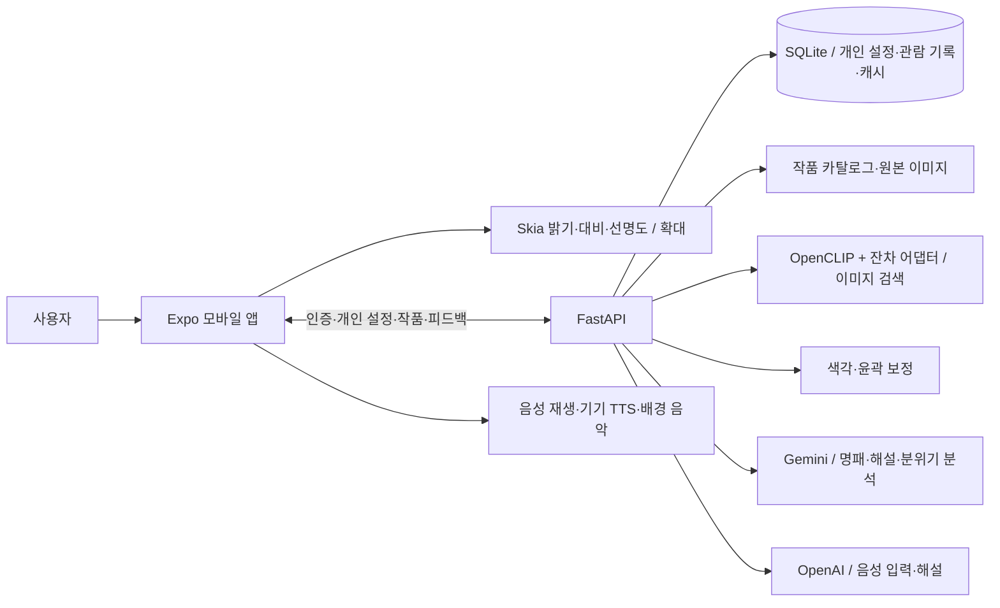

# MoMi

### 모두가 같은 작품을, 각자의 방식으로

**저시력·색각이상 사용자를 위한 개인 맞춤 미술 감상 앱**입니다. 작품을 사진·명패·QR·번호·음성으로 찾고, 나에게 맞춘 색·명암·윤곽 보정과 확대, 음성 해설로 감상합니다.

회원가입부터 보기 설정, 작품 찾기, 보정·해설, 감상 후 피드백과 관람 기록까지 모바일 앱과 백엔드를 연결한 시연 버전입니다. `main`에서 최종 통합본을 관리합니다.

## 주요 기능

| 기능 | 구현 내용 |
| --- | --- |
| 계정과 개인 설정 | 회원가입·로그인, 세션 관리, 계정별 보기 설정과 관람 기록 |
| 화면 맞추기 | 색 구분·윤곽·대비 확인, 단계별 보정 선택, 숫자 답 음성 입력, 결과 저장 |
| 작품 찾기 | 미술관별 목록·번호·QR, 작품 사진 검색, 명패 글자 인식, 제목·작가 음성 검색 |
| 개인 맞춤 보정 | 적색·녹색·청색 계열 보정, 윤곽선 강조, 대비·밝기·선명도 조정, 원본 비교 |
| 크게 감상하기 | 핀치 줌, 확대 화면과 가로 보기 |
| 맞춤 음성 해설 | 객관적 시각 정보와 감정적 해석 구분, 문장별 재생·속도 조절, 영역 정보가 있는 해설의 따라 확대 |
| 분위기 음악 | 해설의 분위기·에너지에 맞춰 준비된 20곡 중 선택, 음량과 켜기·끄기 조절 |
| 미등록 작품 감상 | 촬영본으로 일반 해설 생성, 미검수 결과 표시, 감상 후 피드백 |
| 피드백과 기록 | 음성·선택형 피드백으로 보기·해설 설정 조정, 감상 당시 보정값 다시 보기 |

## 사용자 흐름

```text
회원가입·로그인 → 온보딩·화면 맞추기 → 개인 설정 저장
                                      ↓
미술관 선택 → 작품 찾기 → 원본·보정본 비교와 확대
                                      ↓
                      음성 해설·영역 안내·배경 음악
                                      ↓
                         감상 피드백 → 관람 기록
```

등록 작품은 카탈로그 이미지를 사용합니다. 사진 검색 결과가 불확실하면 후보 확인 또는 재촬영으로 안내하고, 미등록 작품은 촬영본 분석으로 연결합니다. 자동 인식 오답 가능성이 있어 작품명과 후보를 함께 확인해야 합니다.

## 시스템 구성



### 작품 인식

OpenCLIP 이미지 임베딩과 등록 원본의 코사인 유사도를 비교합니다. CLIP 본체를 고정하고 작은 잔차 어댑터를 학습해 촬영 조건에 적응시키는 구조입니다. 인식 점수는 정답 확률이 아니며, 임계값과 작품 여부 판별에 따라 자동 이동·후보 확인·미등록 분석·재촬영을 구분합니다.

### 이미지 보정

서버가 사용자 설정에 따라 색각·윤곽 보정 이미지를 만들고, 앱은 Skia로 밝기·대비·선명도와 원본 대비 보정 강도를 조절합니다. 적·녹색 계열은 혼동하는 색과 경계를 중심으로 보정하며, 어두운 작품은 평균 밝기를 보존하는 대비 곡선을 사용합니다.

기본 색 보정은 `selective`입니다. `COLOR_CORRECTION_MODE=cluster`는 별도 실험 모드이며 [실험 결과와 서버 연결 조건](docs/experiments/palette-v3/server-integration.md)을 확인한 뒤 사용합니다.

### 해설과 음악

등록 작품의 검수 해설과 AI 생성 해설을 구분합니다. 해설·음성은 캐시를 재사용하고 외부 생성·음성 API에는 예산과 호출량 제한을 적용합니다. 배경 음악은 분위기 10종 × 에너지 2종의 기존 음원에서 선택합니다. [음원 출처와 이용 조건](Backend/music/CREDITS.md)을 함께 관리합니다.

## 기술 스택

| 영역 | 기술 |
| --- | --- |
| 모바일 | TypeScript, React Native, Expo SDK 58, Expo Router |
| 보정·확대 | React Native Skia, Gesture Handler, Reanimated |
| 촬영·음성·저장 | Expo Camera, Image Manipulator, Audio, Speech, SecureStore, AsyncStorage |
| 백엔드 | Python 3.12, FastAPI, Uvicorn, SQLite |
| 이미지·검색 | PyTorch, OpenCLIP, NumPy, OpenCV, Pillow, pillow-heif, RapidFuzz |
| 생성·음성 | Gemini API, OpenAI 음성 API, 기기 TTS |
| 인증 | Argon2 비밀번호 해시, 만료·폐기 가능한 Bearer 세션 |
| 실행·운영 | Docker, 모델·생성 캐시, 시연 서버 감독 실행기 |

## 로컬 실행

Python 3.12, uv, Node.js·npm과 SDK 58을 지원하는 Expo Go가 필요합니다. 아래는 macOS·Linux 기준입니다.

### 1. 백엔드

```bash
git clone https://github.com/lamyoon815-byte/SWAITHON.git MoMi
cd MoMi/Backend
uv venv --python 3.12 .venv
uv pip install --python .venv/bin/python -r requirements-ai.txt -r requirements-dev.txt
cp .env.example .env
./.venv/bin/python import_catalog.py catalog.demo.json
./.venv/bin/python build_index.py
./.venv/bin/python -m uvicorn main:app --host 0.0.0.0 --port 8000
```

기존 `.env`가 있다면 복사하지 말고 필요한 항목만 추가합니다. 처음 인덱스를 만들 때 CLIP 가중치를 내려받습니다. 학습된 어댑터는 Git에 포함되지 않으므로 준비된 파일을 `Backend/data/clip-adapter.npz`에 두거나 `CLIP_ADAPTER=off`로 기본 CLIP을 사용합니다. 인식 임계값을 비워두면 후보 확인 경로를 사용합니다.

- 서버 상태: <http://127.0.0.1:8000/health>
- DB 준비 상태: <http://127.0.0.1:8000/ready>
- API 문서: <http://127.0.0.1:8000/docs>

기본 실행은 모나리자 1점으로 확인합니다. 확장 카탈로그의 이미지·DB·검색 인덱스·학습 가중치·생성 캐시는 `Backend/data/`에 별도로 준비해야 합니다. 공개 작품 수집·재다운로드·등록 방법은 [백엔드 안내](Backend/README.md#카탈로그-등록)를 참고하세요.

### 2. 외부 API 설정

`Backend/.env`의 `GEMINI_API_KEY`, `GEMINI_MODEL`, `OPENAI_API_KEY`와 음성 관련 항목을 설정합니다. 상세 항목은 [환경변수 예시](Backend/.env.example)에 있습니다. 키는 서버에서만 관리합니다.

키가 없어도 회원·개인 설정·카탈로그와 로컬 보정을 확인할 수 있습니다. 새 명패 인식·생성 해설·음성 입력·AI 음성 생성은 해당 외부 API 설정과 인터넷 연결이 필요합니다.

### 3. 모바일 앱

새 터미널에서 실행합니다. `<PC_IP>`를 백엔드를 실행한 PC의 내부 IP로 바꿉니다.

```bash
cd MoMi/Frontend
npm ci
EXPO_PUBLIC_API_URL="http://<PC_IP>:8000" npm start
```

같은 네트워크의 휴대폰에서 Expo Go로 QR을 스캔합니다. 다른 네트워크에서는 백엔드에 접근 가능한 HTTPS 주소를 준비하고, 앱은 `npm start -- --tunnel`로 실행합니다. Expo 터널과 백엔드 주소는 각각 필요합니다.

기존 데이터·모델을 준비한 시연 환경에서는 저장소 루트에서 `Backend/.venv/bin/python -m Backend.run_demo`로 서버를 실행할 수 있습니다. [시연 실행과 백업 안내](Backend/README.md#학교-시연-실행)를 참고하세요.

## 검증

저장소 루트에서 백엔드 테스트를 실행합니다. 기본 보정 모드를 명시해 로컬 실험 설정의 영향을 분리합니다.

```bash
CLIP_WARMUP=0 COLOR_CORRECTION_MODE=selective HF_HUB_OFFLINE=1 Backend/.venv/bin/python -m unittest discover -s Backend/tests -v
cd Frontend
node --test scripts/tests/*.test.cjs
npm run lint
./node_modules/.bin/tsc --noEmit
```

2026-11-13 최종 통합 검증:

| 검사 | 결과 |
| --- | --- |
| 백엔드 unittest | 241개 통과, 선택형 C 커널 포함 |
| C 커널 없는 기본 환경 | 237개 통과, C 커널 전용 4개 건너뜀 |
| 프론트엔드 테스트 | 98개 통과 |
| Expo lint / TypeScript | 통과 |

자동 테스트는 인증·데이터 분리·API 계약·보정 계산·인식 분기·해설·피드백·모바일 순수 로직을 확인합니다. 실제 미술관 촬영 성능, 대상 사용자의 체감과 iOS·Android 실기기 접근성은 별도 검증 항목입니다.

## 데이터와 적용 범위

- 확장 카탈로그 JSON은 해외 미술관 공개 자료와 국내 작품 자료를 포함합니다. 카탈로그 수는 학습 표본 수나 인식 정확도를 뜻하지 않습니다.
- 작품·이미지·설명문·음원의 출처와 라이선스는 항목별로 확인합니다. 모든 자료가 CC0인 것은 아니며, 미술관 표시가 제휴를 의미하지 않습니다.
- 보정 설정은 감상을 돕기 위한 개인 선호입니다. 화면 맞추기는 의료 진단 검사가 아니며 임상 효과를 검증한 제품이 아닙니다.
- 미등록 작품의 AI 해설은 미검수 결과입니다. 역사적 사실과 발음은 검토가 필요합니다.
- 유사한 작품의 오인식과 자동 이동 오답이 발생할 수 있습니다. 작은 평가셋의 결과를 전체 서비스 정확도로 확대하지 않습니다.

## 디렉터리와 개발 문서

```text
MoMi/
├── Frontend/              # Expo 앱, 접근성 UI, 보정·음성 재생
│   ├── src/app/           # 인증·온보딩·작품 감상·마이페이지
│   ├── src/lib/           # API·보정·재생·음성 검색 로직
│   └── scripts/tests/     # 프론트엔드 테스트
├── Backend/               # FastAPI, 인증·카탈로그·해설·피드백
│   ├── ai/                # 인식·보정·캘리브레이션·학습·평가
│   ├── music/             # 배경 음악과 출처
│   ├── tests/             # 백엔드 테스트
│   └── data/              # DB·원본·가중치·캐시, Git 제외
└── docs/                  # API 규격·설정 규칙·보정 실험 기록
```

- [백엔드 설치·API·데이터·시연 운영](Backend/README.md)
- [프론트엔드 화면·디자인·개발 규칙](Frontend/README.md)
- [API 규격](docs/api-spec.md)
- [화면 맞추기와 보정 설정 규칙](docs/ai-calibration.md)
- [색 보정 실험 결과](docs/experiments/palette-correction/report.md)
- [작품 인식 부하·실행 정책](docs/recognition-load.md)

기능 작업은 브랜치에서 진행하고 `develop`에서 통합한 뒤 `main`에 반영합니다. 실험 코드는 문서의 적용 조건을 확인해 사용합니다.
